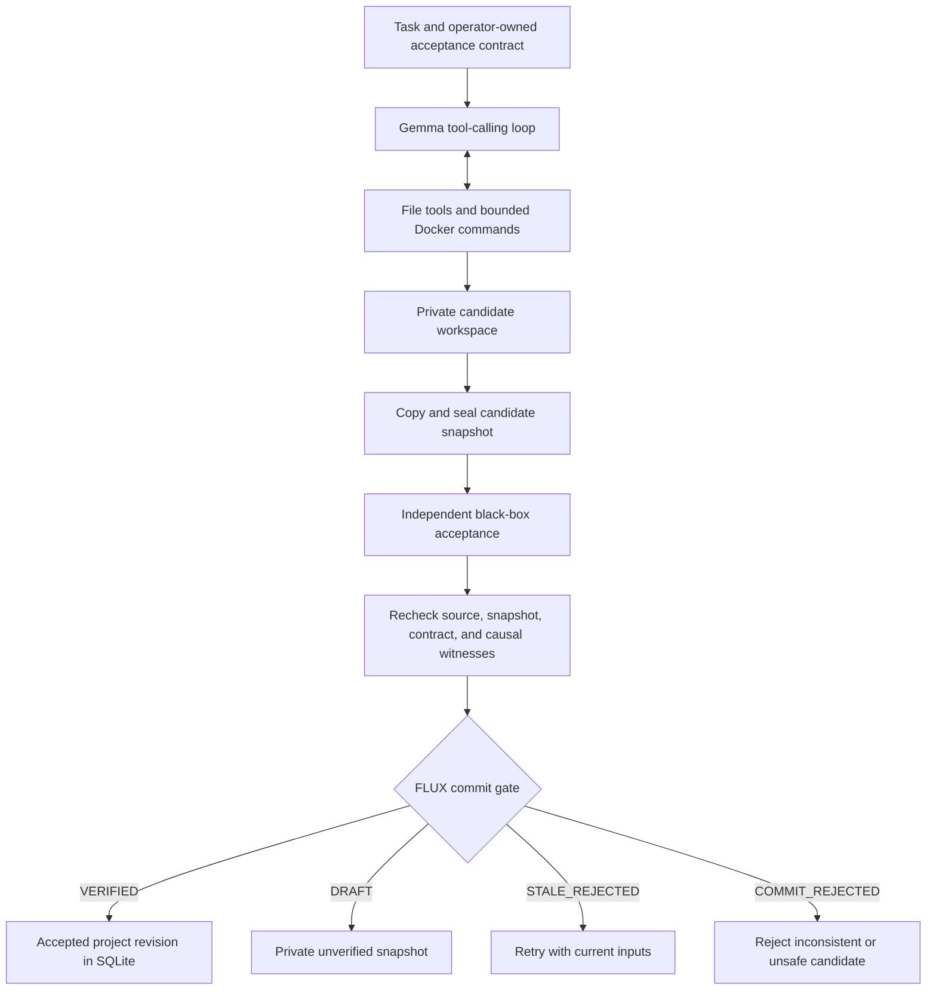

# FLUX//OS

**A backend for coding agents that tracks changing inputs, independently checks candidate code, and commits accepted project revisions.**


FLUX//OS combines a Gemma tool-calling loop, private coding workspaces, Docker execution, and a SQLite causal commit kernel. It explores a practical question: **when requirements or source files change, can an agent preserve unaffected work while rejecting results built on stale inputs?**

This is the **v0.6.0 backend-only shared-memory release**. It includes a CLI, FastAPI service, and project-scoped shared-memory tools for Gemma and its workers. There is no application frontend. Improvements in model accuracy, token efficiency, or task completion have not been established by a live comparative benchmark.

## Contents

- [Features](#features)
- [How it works](#how-it-works)
- [Shared memory](#shared-memory)
- [Requirements](#requirements)
- [Quick start](#quick-start)
- [Run a real coding task](#run-a-real-coding-task)
- [Configuration](#configuration)
- [CLI commands](#cli-commands)
- [API reference](#api-reference)
- [Project structure](#project-structure)
- [Verification and testing](#verification-and-testing)
- [Security and limitations](#security-and-limitations)
- [Troubleshooting](#troubleshooting)
- [Documentation](#documentation)
- [Contributing](#contributing)
- [License](#license)

## Features

| Capability | Behavior in v0.6.0 |
| --- | --- |
| Causal dependency tracking | Records observed facts and file hashes; rejects publication when recorded dependencies are stale. |
| Private candidates | Keeps proposed changes separate from the accepted project revision. |
| Sealed acceptance | Copies and seals candidate files before running an operator-owned acceptance contract, then rechecks their hashes. |
| Persistent projects | Stores accepted revision history and exports the current accepted project as a ZIP. |
| Coding tools | Lists, searches, reads, writes, and exactly edits files; supports paginated reads and staged changes with SHA-256 preconditions. |
| Bounded workers | Supports an optional batch of up to three child coding workers with conflict-checked merges. |
| Container execution | Runs Python or Node commands through Docker with resource limits and networking disabled. |
| Execution history | Records model, tool, and publication events in SQLite for inspection. |
| Offline demos | Demonstrates stale-input detection and selective repair without model calls or Docker. |
| Conditional shared memory | Version checks and atomic field patches prevent blind overwrites; disjoint edits preserve one another. |
| Shared Gemma tools | Project-scoped reads, conditional text-note patches, and explicitly unverified claims shared with delegated workers. |
| Interrupted-job fencing | Stops cancelled or interrupted workers and their children from writing shared notes or claims using an obsolete generation. |

The kernel is the single commit authority. Model output and a reported developer-test PASS cannot independently authorize publication.

## How it works



Acceptance checks a Python CLI's exact stdout and exit code for operator-defined stdin cases. Expected outputs stay outside the model's candidate workspace. The checked snapshot and acceptance contract hashes are bound to the committed revision.

`VERIFIED` means the configured acceptance cases passed under these boundaries. It does not prove arbitrary code is correct or secure. `DECLARED_CURRENT`, used in the causal demos, means recorded dependencies remain current; it is a separate property from acceptance.

## Shared memory

Gemma can call these tools during a normal coding run:

| Tool | Behavior |
| --- | --- |
| `read_shared_memory` | Reads a JSON-object pointer in this project's unverified notes; reports the value, field hash, and version, or an explicit absence. |
| `patch_shared_memory` | Atomically edits 1–16 previously read fields using their hashes. Model-facing values are text notes, each at most 8 KB. |
| `record_shared_claim` | Appends a text assertion and a declared evidence source within the project. |
| `read_shared_claims` | Lists visible assertions for a predicate and reports `UNCONTESTED`, `DISPUTED`, or `UNAVAILABLE`. |

For example, ask the agent to read `/plan`, store its implementation plan using the returned `expected_hash` (or `null` for an absent field), and then implement the task. Use exact field reads rather than reading the entire note store when only one field is needed. Workers inherit the parent's memory namespace; different project IDs have separate namespaces. Later runs on the same project reuse the persisted notes.

The host validates the complete recorded read set in the same SQLite transaction as each patch. It advances witnesses to the exact result of the agent's own write, so a successful edit does not make its own work stale. Another worker's conflicting changes are not silently refreshed into the observation.

Notes and claims are **unverified coordination data**. They persist even when a code run is rejected or remains a draft; they are not rolled back with candidate files. Claims do not authorize publication, resolve semantic truth, or replace independent acceptance. Claim listings are advisory rather than causal read witnesses. Shared fact reads are witnessed and can invalidate dependent work when their values change; automatic repair remains unimplemented.

Inspect notes through `GET /api/projects/{project_id}/memory`. The trusted Python API additionally supports conditional whole-fact writes, JSON object patches, negative dependencies, and job reconciliation. See the [shared-memory guide](docs/SHARED_MEMORY_INTEGRATION_v0.6.0.md).

## Requirements

- **Python 3.11 or newer**, with `pip` and `venv`.
- **Git** to clone the repository.
- For live model runs: a **`GEMINI_API_KEY`** with access to the model configured in `src/fluxos/agent.py`.
- For candidate commands and independent acceptance: **Docker**, a running daemon capable of Linux containers, and the required images already pulled.

Offline demos and unit/mock tests do not need an API key or Docker. On Windows, Docker must be configured for Linux containers. Local v0.6 tests returned **159 passed, 3 skipped, 0 failed**. The three symlink tests require Windows symlink privileges. See [v0.6 verification](docs/FINAL_VERIFICATION_v0.6.0.md) for scope and results.

## Quick start

### 1. Clone and install

```bash
git clone https://github.com/Bharath122babu/FLUX-OS-UNIFIED.git
cd FLUX-OS-UNIFIED
python -m venv .venv
```

Activate the virtual environment:

**Windows PowerShell**

```powershell
.\.venv\Scripts\Activate.ps1
```

**Linux / macOS**

```bash
source .venv/bin/activate
```

Install the package and test dependencies:

```bash
python -m pip install -e ".[test]"
python scripts/preflight.py
```

### 2. Try the offline demo

```bash
fluxos unified-demo
```

The demo changes a source contract from `email` to `student_id`, marks the dependent frontend artifact stale, and repairs it while preserving the independent style artifact. Its JSON report includes `model_calls: 0` and `demo_type: DETERMINISTIC_FILE_HASH_DEPENDENCIES_NO_GEMMA`.

### 3. Start the backend

```bash
fluxos serve --home .fluxos --port 8765
```

- Interactive API documentation: [http://127.0.0.1:8765/docs](http://127.0.0.1:8765/docs)
- Health check: [http://127.0.0.1:8765/api/health](http://127.0.0.1:8765/api/health)
- Service descriptor: [http://127.0.0.1:8765/](http://127.0.0.1:8765/)

The server binds to `127.0.0.1`. Keep it on a trusted local development machine.

## Run a real coding task

### 1. Prepare Docker

Start the local Docker daemon and pull the runtime images:

```bash
docker info
docker pull python:3.12-alpine
docker pull node:22-alpine
```

Python is required for the current acceptance runner; Node is needed only for Node development commands. The runtime uses `--pull never` and `--network none`, so it cannot fetch missing images or install packages over the network during a task. There is no host subprocess fallback.

### 2. Set the model credential

Set the environment variable in the terminal that will launch the server.

**Windows PowerShell**

```powershell
$env:GEMINI_API_KEY = "your-api-key"
```

**Linux / macOS**

```bash
export GEMINI_API_KEY="your-api-key"
```

The application reads the process environment; it does **not** automatically load `.env` files. Never commit credentials. Live requests use the configured provider and may consume your provider quota.

### 3. Provision the acceptance contract

Before submitting a task, put an operator-controlled contract at:

```text
<home>/acceptance/<project_id>/cases.json
```

For the default home and project `demo`, copy the included example.

**Windows PowerShell**

```powershell
New-Item -ItemType Directory -Force .fluxos/acceptance/demo | Out-Null
Copy-Item examples/blackbox-acceptance/cases.json .fluxos/acceptance/demo/cases.json
```

**Linux / macOS**

```bash
mkdir -p .fluxos/acceptance/demo
cp examples/blackbox-acceptance/cases.json .fluxos/acceptance/demo/cases.json
```

The example expects a `main.py` program that reads two integers and prints their sum:

```json
{
  "entry": "main.py",
  "cases": [
    {"stdin": "2 3\n", "stdout": "5\n", "exit_code": 0},
    {"stdin": "10 25\n", "stdout": "35\n", "exit_code": 0},
    {"stdin": "-5 7\n", "stdout": "2\n", "exit_code": 0}
  ]
}
```

Contracts support **1–12 cases** and a Python `.py` entrypoint. Stdout is compared exactly, including newlines. Keep the contract outside candidate-editable files and do not change it during a run.

### 4. Start the server and submit the task

```bash
fluxos serve --home .fluxos --port 8765
```

In another terminal, use the interactive `/docs` page or send this request.

**Windows PowerShell**

```powershell
$body = @{
    project_id = "demo"
    task = "Build main.py: read two integers from stdin and print only their sum followed by a newline. Support negative integers."
} | ConvertTo-Json

$result = Invoke-RestMethod -Method Post `
    -Uri "http://127.0.0.1:8765/api/gemma/run" `
    -ContentType "application/json" -Body $body
$result | ConvertTo-Json -Depth 10
```

**Linux / macOS**

```bash
curl -X POST http://127.0.0.1:8765/api/gemma/run \
  -H 'Content-Type: application/json' \
  -d '{"project_id":"demo","task":"Build main.py: read two integers from stdin and print only their sum followed by a newline. Support negative integers."}'
```

This endpoint is synchronous and can take several model and container calls to return. Record the returned `job_id` to inspect execution events.

| Result | Meaning |
| --- | --- |
| `VERIFIED` | Independent acceptance passed and the sealed revision was committed. |
| `DRAFT` | Files were produced, but independent acceptance was missing, unavailable, or unsuccessful. The accepted project head does not advance. |
| `STALE_REJECTED` | An input, contract, or project revision changed. Inspect the reason and submit a fresh run manually. |
| `COMMIT_REJECTED` | Integrity, authorization, or workspace validation prevented publication. |
| `INCOMPLETE` | The run did not produce candidate files. |

### 5. Inspect and export accepted work

```bash
curl http://127.0.0.1:8765/api/projects/demo
curl http://127.0.0.1:8765/api/projects/demo/export -o accepted.zip
```

On PowerShell, use `curl.exe` for these curl commands, or `Invoke-RestMethod` and `Invoke-WebRequest`. Export requires an accepted revision; a draft alone cannot be exported through this endpoint. Later runs using the same `project_id` start from its accepted head.

## Configuration

| Setting | Default | How to set it |
| --- | --- | --- |
| API credential | Unset | `GEMINI_API_KEY` environment variable. Required only for real model runs. |
| Model | `gemma-4-26b-a4b-it` | `GEMMA_MODEL` environment variable; an explicit `GemmaClient(model=...)` argument takes precedence. There is no CLI model flag. |
| State directory | `.fluxos` | `fluxos serve --home <directory>` |
| Server port | `8765` | `fluxos serve --port <port>` |
| Server host | `127.0.0.1` | Fixed by the CLI launcher. |
| Acceptance contract | Per-project `cases.json` | `<home>/acceptance/<project_id>/cases.json` |

Project IDs must contain 1–64 letters, digits, underscores, or hyphens. Tasks must be 5–1500 characters. The run API also accepts optional base64-encoded PNG, JPEG, or WebP input, with a 2 MB decoded image limit; see `/docs` for its schema.

State under `<home>` includes `gemma_state` for SQLite state, `gemma_workspace` for candidates and retained snapshots, `acceptance` for contracts, and `causal_demo` for the separate demo. Preserve the database **and** associated snapshot directories when retaining project history.

## CLI commands

| Command | Purpose |
| --- | --- |
| `fluxos unified-demo` | Demonstrate file-hash dependencies, stale detection, and selective repair in a temporary directory. |
| `fluxos demo --home .fluxos` | Run the causal demo and print before/change/repair statuses. |
| `fluxos benchmark` | Report work units and timings for a fixed synthetic selective-repair workload; makes zero model calls. |
| `fluxos serve --home .fluxos --port 8765` | Start the local FastAPI backend. |
| `fluxos --help` | Show commands and flags. |

`benchmark` is an illustrative mechanics comparison. Its timing and work-unit counts do not establish model-quality or framework-performance improvement.

## API reference

| Method | Endpoint | Purpose |
| --- | --- | --- |
| `GET` | `/` | Backend service descriptor. |
| `GET` | `/api/health` | Configuration summary and whether a model key is present; does not test the key or Docker. |
| `POST` | `/api/gemma/run` | Run a coding task against a project's accepted revision. |
| `GET` | `/api/projects/{project_id}` | Read accepted head and revision history. |
| `GET` | `/api/projects/{project_id}/export` | Download accepted source as a ZIP. |
| `GET` | `/api/projects/{project_id}/memory` | Inspect persisted unverified project notes and their version. |
| `GET` | `/api/jobs/{job_id}/events` | Read job state and recorded execution events. |
| `GET` | `/api/demo` | Initialize if necessary and read deterministic demo state. |
| `POST` | `/api/demo/reset` | Reset the deterministic demo. |
| `POST` | `/api/demo/change` | Change a demo contract field, e.g. `{"field":"student_id"}`. |
| `POST` | `/api/demo/repair` | Repair affected demo artifacts. |
| `GET` | `/docs` | Interactive OpenAPI documentation. |

## Project structure

```text
.
├── src/fluxos/
│   ├── agent.py          # Gemma client, workspace tools, workers, acceptance runner
│   ├── api.py            # FastAPI routes and project workflow
│   ├── benchmark.py      # Synthetic work-unit comparison
│   ├── cli.py            # fluxos command-line entrypoint
│   ├── demo.py           # Causal facts/artifacts demonstration
│   ├── executor.py       # Bounded Docker Python/Node execution
│   ├── gateway.py        # Seal, evaluate, validate, and publish gate
│   ├── kernel.py         # SQLite facts, artifacts, witnesses, jobs, project heads
│   ├── shared.py         # Project-scoped shared-memory tools and bounds
│   └── unified_demo.py   # File-hash dependency demonstration
├── tests/                # Unit, regression, and mock integration tests
├── scripts/              # Readiness, 20-worker stress, and real Docker smoke checks
├── examples/
│   ├── blackbox-acceptance/  # Current Python CLI acceptance example
│   └── acceptance/           # Developer unittest example
├── docs/                 # Release notes, security, audits, design history
├── artifacts/            # Original release verification record
├── pyproject.toml        # Package metadata, dependencies, CLI, pytest settings
└── LICENSE               # MIT license
```

## Verification and testing

From the installed virtual environment:

```bash
python -m pytest -q
python scripts/shared_memory_stress.py
fluxos unified-demo
fluxos benchmark
```

The v0.6 suite contains **162 test cases**. Local Windows verification returned **159 passed, 3 skipped, 0 failed**, with the three skips caused only by missing symlink privileges. The 20-worker stress test preserved all **240 disjoint edits**, with **zero lost updates**, and rejected 19 of 20 competing same-field writes.

GitHub Actions runs the suite, stress check, and offline demos on Ubuntu and Windows with Python 3.11 and 3.12. The Ubuntu Python 3.12 job additionally runs `scripts/docker_acceptance_smoke.py` with actual Python and Node containers and a scripted model. This exercises accepted project revisions, shared-note reuse, ZIP export, and wrong-output rejection. It makes **zero live Gemma requests** and is not a container penetration test.

See the [v0.6 verification record](docs/FINAL_VERIFICATION_v0.6.0.md). The supplied [v0.5 record](artifacts/VERIFICATION_v0.5.0.json), [v0.6 archive record](artifacts/VERIFICATION_v0.6.0.json), and [Windows repair history](docs/LOCAL_VERIFICATION_2026-10-18.md) are preserved as historical evidence. Live Gemma validation remains pending a credential; measured model-performance improvement is unproven.

## Security and limitations

This system is intended for **trusted, single-host local research**. Loopback checks do not provide authenticated users or production tenant isolation. Do not expose the API publicly or give candidate execution access to secrets, personal data, or the host Docker socket.

- Candidate commands use Docker with no network, dropped capabilities, a nonroot identity, and CPU/memory/process limits. This has not been certified as a hardened sandbox.
- `run_tests` supplies developer feedback. Candidate Python can interfere with its in-process unittest framework, so it cannot authorize `VERIFIED`.
- Snapshot permissions discourage accidental writes; privileged or same-user host processes can still tamper with files. Hash checks detect changes at validation boundaries.
- SQLite commits the project head and artifact pointer transactionally. Candidate directory swaps are not fully atomic across operating-system crashes.
- Event history is diagnostic metadata, not a replayable conversation checkpoint or an exactly-once execution guarantee.
- Causal tracking covers recorded observations. Arbitrary command calls conservatively witness the whole registered source tree; hidden reads are not proven observable.

Remaining work includes durable conversation resumption, automatic model-driven repair after stale rejection, an MCP stdio client, permission approvals, Git integration within the harness, PTY/background jobs, independent JS/TS/browser acceptance, live adversarial Docker tests, and same-model A/B evaluation.

## Troubleshooting

| Symptom | Action |
| --- | --- |
| `fluxos` is not recognized | Activate the virtual environment and rerun `python -m pip install -e ".[test]"`. Alternatively use `python -m fluxos.cli unified-demo`. |
| PowerShell blocks activation | Invoke `.\.venv\Scripts\python.exe` and `.\.venv\Scripts\fluxos.exe` directly. |
| Model endpoint returns HTTP 422 for missing configuration | Set `GEMINI_API_KEY` before launching the server. |
| Provider rejects a request | Check the configured model, credential access, and quota with your provider. Key presence in `/api/health` does not establish validity. |
| Commands are unavailable or fail | Confirm `docker info` works and the selected image is present. The harness does not pull images or run commands on the host. |
| Run produces a `DRAFT` | Inspect verification details; ensure the contract matches the project ID, the Python entrypoint exists, Docker is ready, and exact outputs pass. |
| Export returns HTTP 404 | No accepted revision exists. Resolve acceptance and obtain `VERIFIED` first. |
| Request returns HTTP 403 | Use the local address and expected Host header. Browser requests must have the same origin. |
| Port 8765 is occupied | Start with another port, e.g. `fluxos serve --port 8766`, and update request URLs. |
| Three Windows symlink tests are skipped | Python requires Windows Developer Mode or the appropriate privilege to create symlinks. Normal application use does not require these tests. Enable that capability in a suitable test session to exercise them locally; Linux CI exercises real symlinks. |

## Documentation

- [v0.6.0 release notes](docs/RELEASE_NOTES_v0.6.0.md) — current changes and remaining release gates.
- [Shared-memory integration](docs/SHARED_MEMORY_INTEGRATION_v0.6.0.md) — model tools, isolation, conditional writes, and limitations.
- [v0.6 final verification](docs/FINAL_VERIFICATION_v0.6.0.md) — current evidence and live-test readiness.
- [Security](docs/SECURITY.md) — threat model and deployment limitations.
- [Backend engineering decisions](docs/OPEN_CODE_BACKEND_DECISIONS_v0.5.0.md) — design patterns and implementation choices.
- [Original verification record](artifacts/VERIFICATION_v0.5.0.json) — original release test and environment claims.
- [Local verification, October 18, 2026](docs/LOCAL_VERIFICATION_2026-10-18.md) — installation, demos, and Windows test results for this publication.
- [Architecture history](docs/ARCHITECTURE.md) and [unified core history](docs/UNIFIED_CORE.md) — historical context; use current release notes for present behavior.
- [Gemma benchmark plan](docs/GEMMA_BENCHMARK_PLAN.md) — proposed evaluation methodology.

Earlier audit, submission, and release documents are retained for traceability and may describe superseded behavior. This README, the v0.6.0 release notes, the shared-memory guide, and the security document provide current guidance.

## Contributing

Open an issue describing a reproducible problem or proposed improvement. For code changes, create a branch, add an appropriate regression test, run the suite and offline demo, and submit a pull request. Distinguish live-provider results, mock-test results, and benchmark claims. Never include API keys, local databases, or generated project workspaces.

## License

Released under the [MIT License](LICENSE). Copyright © 2026 FLUX//OS contributors.
