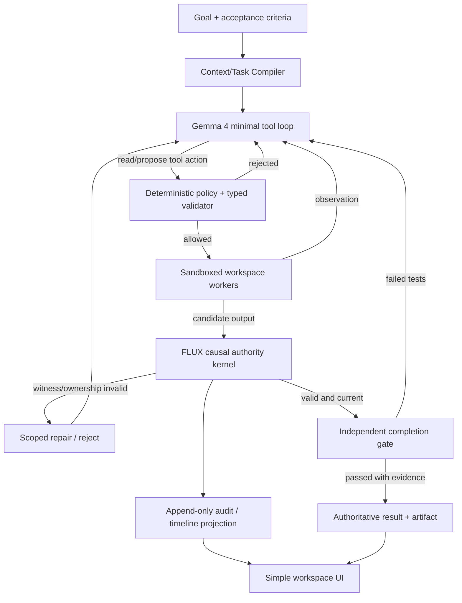

# FLUX//OS — Open-Source Agent Harness Engineering Audit and Build Decision

**Date:** 2026-10-17  
**Status:** Architecture research and experimental plan, not an implemented or benchmarked claim.  
**Goal:** Increase **verified useful completion** of software-development tasks by **Gemma 4** versus the **same exact model** under simpler agent harnesses, without compromising shared-state correctness or cost.  
**Scope:** Representative set of 14 open-source codebases spanning minimal loops, coding agents, durable orchestration, memory, and orchestration middleware. There are many more agent projects; this is not a claim to have read every repository or every file.

## Executive decision

Build one **small, inspectable agent loop** surrounding Gemma 4, and differentiate at three tightly integrated seams:

1. **Gemma Context + Tool Compiler**: delivers precise, relevant code/evidence and bounded tools with provider-correct message construction; does not inflate the model context with a whole shared graph.
2. **FLUX Causal Runtime**: versioned source observations and outputs, consumption manifests, optimistic validation, fenced authority, conservative selective invalidation, crash recovery and safe external-effect reconciliation.
3. **Independent Completion Gate**: tests and acceptance criteria configured before implementation; the model cannot declare completion without passing independent verification.

**One coordinator** supervises typed work contracts; specialist agents are spawned dynamically only for demonstrably independent, bounded subproblems. Agents do not get to adjudicate their own authoritative memory writes. There must be exactly **one authoritative write path**, **one scheduler**, and **one permission kernel**. An event recorder and graph view are projections, not independent memories.

## First-principles invariants

- A model response is a proposal, not evidence that a requirement was satisfied.
- Only recorded/mediated dependencies can be checked. Unknown hidden input means provenance is **uncertified**, not safe.
- Previous context can be shortened, but the immutable goal, acceptance tests, critical constraints, and source-version fingerprints must remain available.
- Conflict and stale validity are separate. A conflicting claim may remain as nonauthoritative evidence without winning a merge.
- A failing/superseded attempt cannot commit results; transactional compare-and-swap of generation/ownership fences is required.
- Shared memory is versioned **artifacts and their witnessed dependencies**, not a shared mutable text buffer or a chat transcript every agent can overwrite.
- An external effect may have occurred before a worker crashes; uncertain outcomes must not be retried blindly.
- OS/process containment is necessary for untrusted tools; prompt rules, approval dialogs, and model-based risk scores are not sandbox isolation.
- Statistical model improvements must be tested across held-out tasks and matched usage budgets, not declared from demonstrations.

## 1 — Primary source audit table

Every row names an actual source entry point. Findings reflect the inspected code/linked documentation at the date of research. Source URLs can drift; individual source files were accessed on their then-current branches. The six-repo comparative audit from 2026-08-04 is useful secondary evidence, not a substitute for direct code checks.

| Project | Inspected implementation | Inner control loop / decision model | Memory / durability | Product interface | Lesson to keep (or reject) |
|---|---|---|---|---|---|
| [mini-SWE-agent](https://github.com/SWE-agent/mini-swe-agent/blob/main/src/minisweagent/agents/default.py) | `src/minisweagent/agents/default.py` (`run`, `step`, `query`, `execute_actions`) | Minimal `model -> tool -> observation`; explicit step/cost/time/format-error limits; single main decision engine | Linear message trajectory, optional serialized trace | CLI, batch runner, trajectory browser | **Control baseline**. Do not assume extra agents help; keep budget enforcement and readable trace. Source SHA `ca310e37d7c61888c576f73f5e1790ac769407b1`. |
| [Pi](https://github.com/earendil-works/pi/blob/main/packages/agent/src/agent-loop.ts) | `packages/agent/src/agent-loop.ts`; `agent.ts` | Stream loop, injectable `prepareRequest`, `prepareNextTurn`, `before/afterToolCall`, tool validation, queued steering | In-memory event/message state delegated to outer harness for persistence | Minimal TUI/CLI and embeddable APIs | **Loop model**. Dependencies injected through seams. Reject an extra LLM planning controller for each tool. Repo was renamed from `badlogic/pi-mono`; SHA `f406aba5647adeb6d879a94d946a52436bfb6af3`. |
| [OpenCode](https://github.com/anomalyco/opencode/blob/dev/packages/opencode/src/session/prompt.ts) | `packages/opencode/src/session/prompt.ts` (dev), [secondary detailed audit](https://github.com/SteveVitali/coding-agent-harness-study/blob/main/research/03-opencode.md) | Session loop, tool registry, provider transforms, permissions, malformed-call handling, edit repair | SQLite sessions, compaction, snapshots | TUI, web/desktop, headless and editor integrations | **Context + editing feedback**. Heavy product surface is optional. Pin changing paths; current dev code changed substantially from Aug. |
| [Goose](https://github.com/aaif-goose/goose/blob/main/crates/goose/src/agents/agent.rs) | Rust `crates/goose/src/agents/agent.rs` | Agent reply state machine, tool inspections, MCP broker, approval strategies, sessions; broad protocol surface | Session manager + history controls | CLI, Electron + ACP clients | **Protocol brokerage** useful later; do not copy hidden side-call overhead or model-as-security-policy. Inspected SHA `e4e1113c5e6605465e5808445fe6b03768477aeb`. |
| [OpenHands SDK](https://github.com/OpenHands/software-agent-sdk/blob/main/openhands-sdk/openhands/sdk/agent/agent.py) | Python `openhands-sdk/.../agent/agent.py` | One step checks pending actions, compacts, calls model, translates actions to events, executes tool batches and handles confirmation | Event/conversation state, condensed context; server-managed workspaces | SDK, server, graphical Agent Canvas | **Isolation and event sourcing**. A long-lived run should survive interruption. Source SHA `28b3472226f4098ac1b6eff33270acca27f1cc0a`. |
| [Cline SDK](https://github.com/cline/cline/blob/main/sdk/packages/agents/src/agent-runtime.ts) | `sdk/packages/agents/src/agent-runtime.ts`, package README | Runtime-agnostic model loop, typed tool hooks, transient retry taxonomy; host implementation lives elsewhere | Snapshot/restore and session storage at outer core layer | IDE, CLI, headless | **Engine/UI separation**, typed lifecycle hooks, stop/retry categories. SHA `d29f0fce82668f4989e886fe6258c9fcb7cbe19f`. |
| [Aider](https://github.com/Aider-AI/aider/blob/main/aider/coders/base_coder.py) | `aider/coders/base_coder.py`, `repo.py`, repo-map usage | Model proposes edits; code validates patch, lint/test, cycles feedback | Git diff/commits and chosen file context | Terminal chat with diff | **Compact structural repository map plus explicit edit/test loop**. Do not dump full repository into context. SHA `56613782b02e756085d930554b8f9deeadeebb28`. |
| [SWE-agent](https://github.com/SWE-agent/SWE-agent/blob/main/sweagent/agent/agents.py) | `sweagent/agent/agents.py` | Task/observation templates, configurable tools, history processors and bounded requeries | Trajectories and sandbox environment | CLI, research/benchmark runner | **Repeatable workflows**. More configurable than mini, but costs complexity. SHA `4844aeb7c42e06121fe37ba223e9263c04b53c3b`. |
| [LangGraph](https://github.com/langchain-ai/langgraph/blob/main/libs/langgraph/langgraph/graph/state.py) | `libs/langgraph/langgraph/graph/state.py` | Typed graph, state channels/reducers, per-node retry policies and routing | Checkpointers, state persistence, graph snapshots | Framework, not a single product UI | **Durable state** is already solved as a generic orchestration problem; FLUX must prove new causal granularity, not relabel checkpointing. SHA `9a87f16fa91a794b2e9be09352c1cb03ae89a90d`. |
| [Deep Agents](https://github.com/langchain-ai/deepagents/blob/main/libs/deepagents/deepagents/graph.py) | `graph.py`, `middleware/subagents.py`, architecture doc | Middleware overlays conventional create-agent loop; task tool creates scoped subagents, possible fork modes, summaries | Backends and middleware-mediated long-term files | SDK/CLI integrations | **One loop + focused middleware**, subagents isolated by context. Avoid hardcoded biology/research specialists; delegate per task. Inspected SHAs `5e08084b17ccbfc051ab891e35508f884813d4f7`, `2eb9b4279918dc09f33cb6e974f4c4863b72772b`. |
| [AutoGen](https://github.com/microsoft/autogen/blob/main/python/packages/autogen-agentchat/src/autogen_agentchat/teams/_group_chat/_base_group_chat.py) | `.../_base_group_chat.py` | Group manager coordinates named participants, shared message broadcasts and termination checks | Team state, runtime topic queues and state restoration | Framework and Studio ecosystem | **Contrast case**. Broadcasting entire conversations is not suitable as our primary authoritative shared-memory model. SHA `60f222912387d37be37f457ad486d51060255966`. |
| [Pydantic AI](https://github.com/pydantic/pydantic-ai/blob/main/pydantic_ai_slim/pydantic_ai/_agent_graph.py) | `.../_agent_graph.py` | Explicit request/tool/result nodes; schema validation, retries, three end strategies (`early`, `graceful`, `exhaustive`) | Optional durable execution providers | Typed Python SDK and optional CLI | **Boundary truth**. A valid output alongside tool calls must not accidentally skip required side effects; use `graceful` or stricter policy. SHA `75870ba82b1cee1b612f9edefb9764c7f075583c`. |
| [Letta Code](https://github.com/letta-ai/letta-code/blob/main/src/skills/builtin/managing-shared-memory/SKILL.md) | Shared-memory skill and `src/agent/prompts/letta.md` (harness behavioral contract, not full internals) | Memory blocks as editable prompt, external files and git-backed shared repositories | Git-revisioned memories and repositories | CLI/desktop and memory viewer | **Important prior art**. File and Git based shared memory already exists. Our differentiator is automatic witnessed causal invalidation + fenced commits, not persistence itself. Skill SHA `70fbb88a566bc6404ad620fe695e3c2b9a727c90`. |
| [CrewAI](https://github.com/crewAIInc/crewAI/blob/main/lib/crewai/src/crewai/crew.py) | `lib/crewai/src/crewai/crew.py`, package docs | Process-oriented crew/team execution, sequential and manager-based variants | Execution context/cache/outputs | Primarily Python SDK/CLI and workflow tooling | **Contrast case**. Task-level manager is useful, but extra agent managers should be justified by evaluation. SHA `fced02558bf0f122d3b6007ffb2889fab462c0a0`. |

**Scope caveat:** Did not run each framework. Code reading shows architectural behavior, not relative accuracy/speed. UI simplicity descriptions are qualitative, not usability-test results. Certain direct paths (OpenCode dev) were read via GitHub web rather than connector because the connector returned an inconsistent 404; the referenced study is pinned to an older commit. For Letta, inspected shared-memory source-level contracts, not the full hosted backend.

### Uncomfortable industry truths

1. Minimal loops already solve impressive coding tasks with powerful models. More control logic can *reduce* completion by adding latency, state inconsistency, and false positives.
2. Persisted chat, Git worktrees and static checkpointers are commonplace; they are not in themselves a unique shared-memory architecture.
3. Every LLM-side agent delegation call incurs additional prompt context and failure modes. Default should be one agent.
4. Model self-judgment of tool safety is advisory; authoritative permissions belong in a separate process/container boundary.
5. `exit code = 0` is not `user requirement passed`.
6. Context engineering and tool schema design may improve Gemma 4 more than multiagent orchestration. This must be tested as an ablation, not assumed.
7. Most runtime diagrams hide the hard problem: what happens after source assumptions change while multiple agents are working?

## 2 — Specific Gemma 4 model engineering

**Official source:** [Gemma 4 Model Card](https://ai.google.dev/gemma/docs/core/model_card_4), [Gemma Gemini API](https://ai.google.dev/gemma/docs/core/gemma_on_gemini_api), [function calling](https://ai.google.dev/gemma/docs/capabilities/text/function-calling-gemma4), [formatting](https://ai.google.dev/gemma/docs/core/prompt-formatting-gemma4).

- The Gemma 4 26B A4B instruction-tuned model has 25.2B total parameters, approximately 3.8B active parameters, and 256K context. We can use the Gemini API model `gemma-4-26b-a4b-it` for a pragmatic hosted first experiment; use **the exact same model and version across baseline and experimental harness**.
- Gemma 4 31B has stronger reported coding / tool-task benchmark scores in Google's model card, but may cost more compute; do not quietly switch it in treatment arm.
- Native function calling requires proper chat template handling and typed argument validation. Generated calls are requests, never actual execution until approved by a separate runtime.
- Think mode is selectable; keep `think on/off` treatment consistent or treat it as a distinct experimental axis. **Do not copy old non-tool-call internal reasoning into future normal conversation turns**, per Google's prompt guide; tools turns have special continuity rules. Don't store private chain-of-thought in shared memory.
- For vision, follow official image-before-text ordering when using the applicable model interfaces; don't overuse images for normal code tasks.
- Fix system instructions, tool definitions, and coding contract into a stable prefix where possible; inject only task-specific live evidence as later context. Whether caching is supported for this specific endpoint must be verified.
- Tool registry must be minimal and semantically disambiguated (e.g., `read_file`, `search_symbols`, `apply_patch`, `run_tests`, `delegate`, `finish`), and each call must have strict JSON schema with explicit typed error reports.
- We should not claim arbitrary thinking-token reductions from an adaptive prompt. Benchmark correctness and cost separately.

### Proposed Gemma-specific experimental improvements

| Mechanism | Hypothesis | Failure mode | How to test |
|---|---|---|---|
| Small, relevant context compiler | Better edit localisation, fewer context distractions | Omits crucial dependency | Freeze hard constraints and source hashes; compare with full-context and naive sliding window |
| Structural code map / symbol search | Fewer wrong-file edits | Index stale or broken | Evaluate held-out repos with stale index perturbations |
| Strict tool schema + graceful retry | Fewer broken tool invocations | More retry tokens | Malformed-call acceptance and task pass vs cost |
| Per-step test diagnostics | Higher useful completion | Tests too weak or model overfits | Hidden independent tests, not only agent-written tests |
| Certified shared-state read manifests | Fewer stale integrations | Hidden read not captured | Instrumented tools, adversarial unmediated reads are uncertified |
| Bounded selective repair | Less rework on changed requirements | Missed dependency, thrashing | Compare full restart and selective repair under same edits |
| Task-conditional spawning | Faster independent code paths | Token overhead, merge conflict | Spawn disabled vs enabled, same aggregate token/time budgets |
| Evidence-preserving compaction | Fewer loops after long sessions | Summary drops vital conditions | Force long-task compaction, check invariant adherence |

## 3 — FLUX//OS proposed minimal kernel

### Internal modules (do not replicate responsibilities)

1. `model_adapter` — Gemma 4 API/runner, templates, tool schema, usage capture, retry classification.
2. `agent_loop` — model turn, tool action, observation, stop and budget; no global state authority.
3. `context_compiler` — goal contract, relevant symbol map, bounded recent observations, durable evidence references.
4. `execution` — workers, sandbox controls, role/capability-bound operations, timeouts and cancellation.
5. `flux_kernel` — **only writer of canonical state**, immutable versions, read witnesses, CAS, ownership epochs, artifact integrity, conflict state, invalidation.
6. `scheduler` — work-contract lifecycle, simple fair queue, dynamic delegation only for independent bounded tasks.
7. `verification` — tests, acceptance contract, strong failure evidence, validation records, irreversible effect gate.
8. `ui_api` — reads event log, streams into product interface; cannot mutate kernel via raw DB access.

### Four permanent state types

- **TaskContract**: id, required result, acceptance checks, capability scope, budget, dependencies, generation.
- **Observation**: source id/version, payload hash, producer identity, read scope, trust/uncertainty.
- **CandidateArtifact**: private output hash, producing attempt, consumption manifest, independent test results, proposed authority transition.
- **EffectIntent**: exact external payload, approval identity/version, stable operation key, status (`PREPARED`, `COMMITTED`, `UNKNOWN_OUTCOME`, `REJECTED`).

`Memory` as a product feature is a read-optimized projection over these durable records. Never let multiple LLMs edit one authoritative Markdown memory blob.

### Decision surface — purposely SMALL

The model may propose only six conceptual actions: `READ`, `MODIFY`, `RUN_TEST`, `DELEGATE`, `REQUEST_APPROVAL`, `FINISH`. Literal tool names can vary; this is the planning grammar.

The **deterministic kernel** decides only these outcomes at every authoritative boundary:

- `ACCEPT`: valid scope, current witnesses, valid generation/ownership fence, independent checks passed.
- `CONTINUE_PRIVATE`: safe speculative work but not yet authoritative.
- `REPAIR`: source changed or validation/test failed; bound repair to affected slice.
- `WAIT`: approval/reconciliation/external dependency required.
- `REJECT`: unauthorized, unsupported, budget exhausted, or stale unsafe commit.

Not an endless LLM debate. An AI expert reviewer can analyze semantic uncertainty, but never override permission, version, or sandbox checks. State-transition decisions are logged with explicit reason codes.

### Scheduling and dynamic agents

Start with **one** Gemma worker. `DELEGATE` is admitted only if (a) deliverable is independent/decomposable, (b) tools/data are scoped, (c) required input version pinned, (d) expected benefit plausibly exceeds spawn + merge cost, and (e) concurrency quota allows it. If no evidence yet on benefits, use deterministic simple rule + max 2 parallel workers in the demo and include a spawn-disabled baseline. Do not invent learned policy gradient scheduling without data.

### Shared-memory transaction example

- `APIContract:v1` published with hash H1.
- UI worker consumes `APIContract:v1`; records exact projection witness.
- Another worker publishes `APIContract:v2` with hash H2 in authoritative transaction.
- UI branch attempts a commit with v1 witness. Kernel refuses stale authority.
- Unrelated `CSS:v3` branch has no affected dependency and remains reusable.
- UI repair rebuilds v2-dependent changes in private branch and re-runs hidden acceptance tests.
- Successful candidate is committed if its witnessed input versions and owner generation remain current at the commit barrier.

This protects observed dependencies, **not unobserved mental influences**. When a worker had unrestricted shell/network reads, certification is not justified.

## 4 — FLUX audit defects that MUST become regression tests

Source: user's **INDEPENDENT_AUDIT_REPORT.md** (2026-10-15). Existing 75 tests passed, but adversarial probes found:

- lower-clearance writer could overwrite/reclassify or revoke secret records (P0);
- same principal at downgraded clearance could overwrite a secret artifact (P0);
- caller-supplied `issuer` could impersonate provenance (P1);
- artifact `VALIDATED` status did not always verify own blob integrity (P1);
- duplicate ancestry caused exponential recursive validation amplification (P1);
- HTTP value and version could come from different snapshots (P2);
- uncertain external effects and hidden reads cannot be treated as automatically safe.

**Stop condition:** no live multi-tenant/untrusted claim until these are demonstrably fixed. A demo may use synthetic sandbox tasks and report honest limitations.

## 5 — User interface: one primary workflow, optional deep view

The UI should feel simple even when execution is sophisticated.

**Default screen:** a single task composer, project/files workspace, concise run status, final verified artifact and one evidence summary. User never configures agent counts/roles/memory graphs by hand.

**Expandable panels:**

- `Workspace` — file tree, preview, changed lines, tests.
- `Activity` — agent progress, cost, actions, cancel/approval; **do not show fake thought streams**.
- `Evidence` — acceptance checks, source version links, why an output was reused/rejected, commit decisions.
- `Judge mode` — baseline vs FLUX//OS under matched task/model/token budget, buttons to inject a breaking API change or worker crash, and compare verified completion, rework and time.

Do NOT build separate screens for every internal classifier, router, specialist agent, graph, memory mode, or risk score. A graph is optional evidence viewer, not the home page.

## 6 — Comparison against simpler alternatives

| Alternative | Accuracy potential | Runtime cost | Complexity | Decision |
|---|---|---|---|---|
| A: plain Gemma 4 + minimal tool loop | Strong baseline; gains depend heavily on model | Low | Low | **Mandatory control arm**, also fallback deployment mode |
| B: large predefined multi-agent manager + shared chat/graph | Uncertain; more failure/merge points | High | High | **Reject default**; allow bounded dynamic specialists only |
| C: context-aware Gemma + single FLUX causal kernel + independent verification | Best falsifiable balance for changed multi-agent code workflows | Moderate overhead; may save repair work | Medium/high | **Selected experiment**, not yet proven |
| D: adopt full OpenHands or Deep Agents and bolt on FLUX | Fast initial scaffolding, but state overlap and policy impedance | Moderate/high | High integration | Can prototype adapters, but **do not create two authoritative runtimes** |

## 7 — Required benchmark plan (NO fake performance claims)

### Experimental arms

- `B0` Gemma 4 one-shot code generation (illustrative only; not a fair harness comparison).
- `B1` minimal loop (mini-SWE-inspired), **same Gemma model**, same tools, same max tokens, same test runner.
- `B2` competent durable harness (e.g., OpenHands/Deep Agents) configured for matched task types and tools. Explicitly note differences in overhead/tool affordances.
- `F1` minimal loop + context compiler.
- `F2` F1 + deterministic completion gate.
- `F3` F2 + FLUX causal memory + selective repair.
- `F4` F3 + bounded dynamic agents (full candidate).

### Tasks

- 10 held-out single-repo code repair and integration tasks, with hidden tests.
- 5 multi-agent stale-contract tests with a deliberately changed API/schema halfway through.
- 3 crash/interrupted-run tests and duplicate-effect readback cases.
- 2 long-context or conflicting-source tests designed to expose overconfident memory compaction.

**20 distinct cases x >=3 stochastic seeds** for meaningful preliminary comparisons. Larger tasks/CI matrices later. Randomize ordering and preserve full trajectories.

### Metrics

1. Independently verified task completion / number attempted.
2. False success rate (agent claims done but hidden checks fail).
3. Causal safety violations (unauthorized write, stale authoritative output, unapproved external effect).
4. Wall time p50/p95, LLM calls, input/output tokens, cost, tool latency, CPU/ram, unnecessary restarts.
5. Saved vs rerun work **only when identical acceptance conditions hold**.
6. Repair correctness after changed assumptions; number of repair cycles.
7. Performance on tasks where **no shared memory is needed**, to quantify FLUX overhead.

**No claim of “Gemma outperforms its normal version” until matched evaluation supports it.** Keep provider/template/model id, thinking settings, context limit, temperature, budgets and tool catalog matched where feasible. Count hidden calls, retries, and judge model tokens. Record error bars rather than a single winning example.

### Acceptance / kill gates

- **Gate 0:** Gemma 4 adapter uses correct native function call framing; all tools validated; 0 unrecorded tool outputs.
- **Gate 1:** All critical FLUX authorization and atomicity regressions fixed in independent tests before untrusted deployments.
- **Gate 2:** A task's independent tests cannot be skipped by `FINISH` or an agent's own claim.
- **Gate 3:** Under changed contracts, zero accepted known-stale artifacts and every provably unaffected artifact preserved.
- **Gate 4:** FLUX//OS statistically improves verified completion or total cost of useful completion over the minimal harness. If not, remove features until benefit appears. A more complex architecture that loses to baseline is not a win.

## 8 — Scope order for the October 18 competition

1. Fixed single task: Gemma edits a simple but real application via typed tools and container, runs tests, produces verifiable result.
2. FLUX memory kernel with source versions, witnesses, CAS and protected commits.
3. Live judge injection: change contract v1→v2; show stale write rejection + selective recovery while unaffected work persists.
4. Visible side-by-side baseline test under same model and known budget.
5. Optional dynamic worker only if parallel advantage is measurable; otherwise leave it as clearly labeled experimental extension.
6. Publish open license and reproducible README; document security boundaries honestly. No fake graphs, staged claims, or hardcoded success.

## 9 — Research sources and links

### Primary repository paths

- mini-SWE: https://github.com/SWE-agent/mini-swe-agent/blob/main/src/minisweagent/agents/default.py
- Pi: https://github.com/earendil-works/pi/blob/main/packages/agent/src/agent-loop.ts
- OpenCode (dev): https://github.com/anomalyco/opencode/blob/dev/packages/opencode/src/session/prompt.ts
- Goose: https://github.com/aaif-goose/goose/blob/main/crates/goose/src/agents/agent.rs
- OpenHands SDK: https://github.com/OpenHands/software-agent-sdk/blob/main/openhands-sdk/openhands/sdk/agent/agent.py
- Cline runtime: https://github.com/cline/cline/blob/main/sdk/packages/agents/src/agent-runtime.ts
- Aider: https://github.com/Aider-AI/aider/blob/main/aider/coders/base_coder.py
- SWE-agent: https://github.com/SWE-agent/SWE-agent/blob/main/sweagent/agent/agents.py
- LangGraph: https://github.com/langchain-ai/langgraph/blob/main/libs/langgraph/langgraph/graph/state.py
- Deep Agents: https://github.com/langchain-ai/deepagents/blob/main/libs/deepagents/deepagents/graph.py
- Deep Agents subagents: https://github.com/langchain-ai/deepagents/blob/main/libs/deepagents/deepagents/middleware/subagents.py
- AutoGen: https://github.com/microsoft/autogen/blob/main/python/packages/autogen-agentchat/src/autogen_agentchat/teams/_group_chat/_base_group_chat.py
- Pydantic AI: https://github.com/pydantic/pydantic-ai/blob/main/pydantic_ai_slim/pydantic_ai/_agent_graph.py
- Letta Code shared memory: https://github.com/letta-ai/letta-code/blob/main/src/skills/builtin/managing-shared-memory/SKILL.md
- CrewAI: https://github.com/crewAIInc/crewAI/blob/main/lib/crewai/src/crewai/crew.py
- Comparative pinned-code study: https://github.com/SteveVitali/coding-agent-harness-study

### Official Gemma sources

- Model card: https://ai.google.dev/gemma/docs/core/model_card_4
- Gemma API: https://ai.google.dev/gemma/docs/core/gemma_on_gemini_api
- Function calling: https://ai.google.dev/gemma/docs/capabilities/text/function-calling-gemma4
- Prompt formatting/thought continuity: https://ai.google.dev/gemma/docs/core/prompt-formatting-gemma4

## Final research verdict

**Build a compact Gemma-focused execution harness sitting on a repaired FLUX causal kernel and an independent completion gate.** Do not build a zoo of permanent agents, graph databases, semantic truth engines, prompt-scored security monitors, or separate schedulers. Those additions would obscure the comparison and multiply failure modes.

Our measurable claim must be **better verified useful completion per compute unit**, particularly when multiple independent agents face **changing shared state**. If the clean single-agent baseline wins, simplify and admit it.
