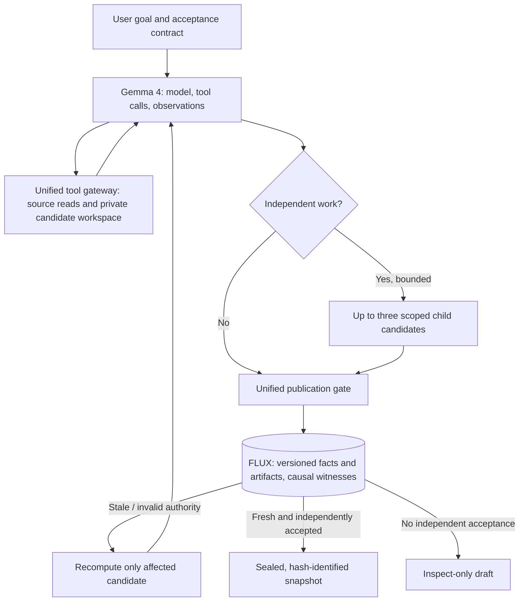

> **Historical document (pre-v0.5.0).** For current backend release and security guarantees, read `README.md`, `docs/RELEASE_NOTES_v0.5.0.md`, and `docs/SECURITY.md` first.

# FLUX//OS v0.3.0 — Unified Core (frozen design)

**Objective:** Let the *same* Gemma 4 model finish more development tasks correctly under changing shared state by eliminating avoidable rework and rejecting stale work. Improvement is a **hypothesis, not a measured result**.

## One model loop, one execution gateway, one authoritative kernel

### Authority boundaries

1. **Gemma chooses actions**, not authority. Model calls use native function-call arguments; limited to known tool names; no direct Python shell, database, or host filesystem access via tools.
2. **The tool gateway mediates file reads** (`repo:<stable-base-path-hash>:tree` fact). The `names` projection witnesses directory membership without automatically invalidating on content-only changes. `/hashes/<escaped path>` witnesses exact source-file bytes. Negative lookups and file creation conservatively witness `names`.
3. **Private candidates and children** are not canonical. Child changes merge only if no same-file conflict and matching fork versions. Generation fencing applies at final authoritative result publication.
4. **UnifiedGate** validates input workspace content hashes, the recorded causal witnesses, independent test evidence, job generation, and candidate snapshot content. It returns one outcome: `COMMIT`, `CONTINUE_PRIVATE`, `REPAIR`, or `REJECT`. `WAIT` is reserved for external effects and approvals, **not implemented** for v0.3.
5. **Memory is the only authoritative store.** Its SQLite transaction revalidates declared inputs when recording an artifact. A JSON dependency graph is a derived view of that store, not another writable truth source.

The agent loop has no permanently assigned subject workers, separate memory authority, AI supervisor, RL router, or second job scheduler. Dynamic subagent spawning is deliberately bounded (maximum three, depth one, single delegation batch) and **optional**.

## Incremental validity vs correctness of thought

A tracked dependency can be valid while the generated code is wrong. `DECLARED_CURRENT` means the *recorded inputs* are still current. `VERIFIED` for a result means a configured operator-controlled test suite was executed and reported passing **under the stated sandbox boundary**, not formal proof or comprehensive goal satisfaction.

The runtime cannot observe hidden model reasoning, unmediated OS access, or arbitrary external effects. In v0.3 workers only have mediated file and test tools, but this is not a general-purpose hardened untrusted code execution system.

## Input-version semantics

The coordinator calls `Memory.register_source_tree` at the start of a run; unchanged source contents do not cause a new version. The agent witnesses the filenames shown in the initial prompt and specific source files read/written. A workspace changed while the candidate executes is rejected by an additional byte-level comparison before publication. A source update registered later invalidates only artifacts whose witnessed projection changed.

This is a conservative, **single-host** protocol. A file change racing *between* the last filesystem check and the SQLite transaction cannot be ruled out if an uncontrolled external writer edits the checkout. Production deployments must prohibit unmanaged canonical-writer access or move the file-manifest pointer and source publication into the same coordinator's atomic protocol.

## Known incomplete parts

- No durable distributed worker queue or automatic recovery of in-flight Gemma conversations.
- No authenticated external service, owner tenancy proof beyond the trusted coordinator, or public internet hardening.
- External non-idempotent effects are unsupported rather than deceptively 'exactly-once'.
- Acceptance tests share a Python interpreter with candidate imports *inside the Docker sandbox*; isolated launcher prevents the demonstrated `-m unittest` module shadow, but adversarial code can manipulate the test interpreter itself. Never call this unbreakable verification.
- Acceptance is currently Python unittest only; no browser or JS/TS integration test runner.
- No live Gemma API key or Docker daemon was available in the build environment. These paths are covered by protocol/mocking and local launcher checks, not live cloud or real container execution.

## Evaluation contract

Use the same model, tool interface, tasks, acceptance suites, retry budgets, source changes, and machine for the baseline and FLUX condition. Measure completed tasks, false acceptance, token use, cost, wall time, and preserved work. Keep runs where FLUX does worse. No Gemma improvement claims before performing those trials.
